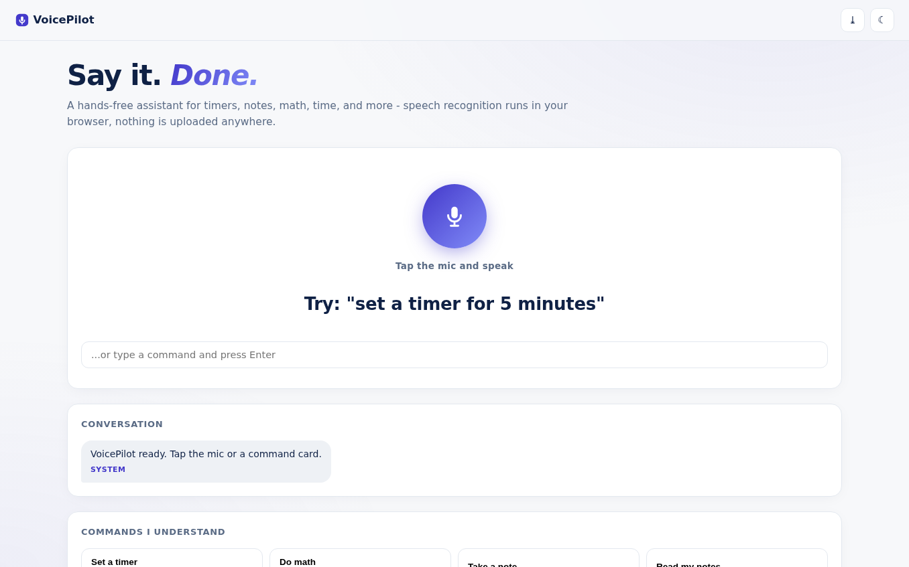
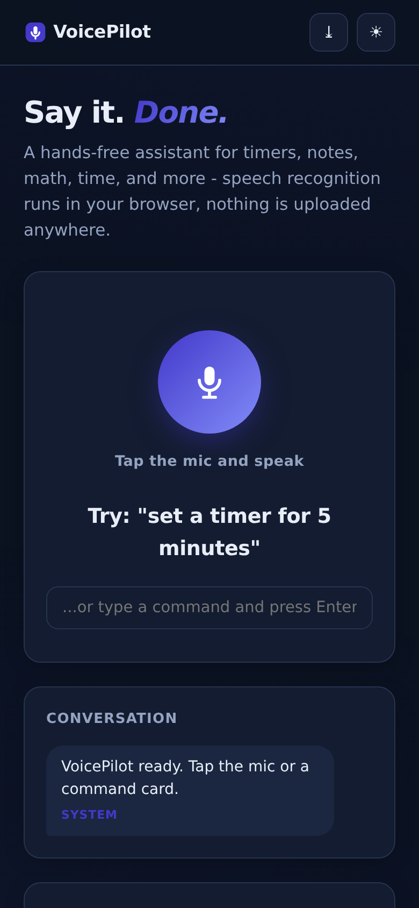

# VoicePilot - Voice Command Assistant

Hands-free assistant with **in-browser speech recognition**: timers, notes, math, time, jokes, dice, countdowns, site launching - typed fallback everywhere.

**Live demo:** https://akash991833.github.io/voice-command-assistant/

## Features

- **Web Speech recognition** with live interim transcripts and a pulsing listening state
- **14 command families** - natural-number parsing ("set a timer for five minutes" works), multi-timer pills with cancel, persistent notes, safe sandboxed calculator, date/time, jokes, coin flips, dice, random numbers, countdowns, site launcher, small talk
- **Spoken responses** via speech synthesis
- **Tappable command grid** - every capability documented with an example that runs on tap
- **Typed input fallback** for browsers without speech recognition (Firefox)
- **PWA** - installable
- **Premium UI** - white professional design, navy ink, indigo accent, dark + light themes, responsive desktop and mobile

## Screenshots

## Honest limits

Speech recognition uses the browser's Web Speech engine; Chrome/Edge may route audio through the vendor's service, Firefox may lack it (typed commands work everywhere). Command understanding is pattern-based NLP, not an LLM. Stated in-app.

## Tech

Vanilla HTML/CSS/JS, Web Speech API, zero dependencies.

## Run locally

Serve the folder (`python3 -m http.server`) - mic access needs localhost or HTTPS.
